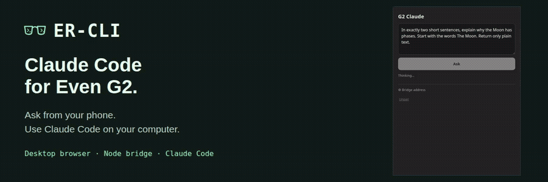
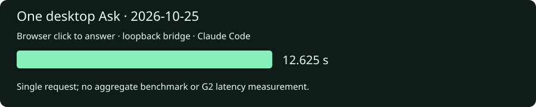
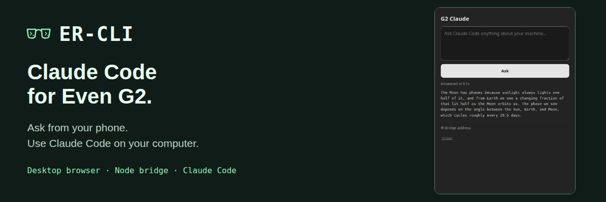

<p align="center"></p>

<h3 align="center">Claude Code for Even G2.</h3>
<p align="center">For G2 users who want answers from Claude Code running on their own computer.</p>
<p align="center"><a href="#install">Install</a> · <a href="docs/SETUP.md">Docs</a> · <a href="docs/BENCHMARKS.md">Results</a> · <a href="#watch">Watch</a></p>

<p align="center"><a href="assets/teaser.mp4"></a></p>

| Result | Scope | Source |
| --- | --- | --- |
| Successful pairing and Ask | Desktop browser → local bridge → Claude CLI | [Request receipt](docs/receipts/desktop-ask.json) |
| 9.556 seconds | One desktop request, click to answer | [Method](docs/BENCHMARKS.md) |
| 73,833-byte app package | SDK 0.0.14, minimum Even app 2.2.9 | [Build receipt](docs/receipts/build.json) |



## What ER-CLI does

ER-CLI is a G2 app and a small Node bridge to your existing Claude Code setup.
Type a question on the phone; the app sends it to your computer and paginates
the answer for the G2 HUD. Scroll up/down to turn pages; double-tap exits. The
installed app is named **G2 Claude**.

Claude Code runs on your computer with its existing tools and login. The app
runs in Even Hub on the phone and sends paginated text to the G2 display.
Model requests use your configured Claude provider.

## News

- **2026-10-25 — v0.1.3:** G2 Claude app, authenticated Node bridge, desktop
  walkthrough and SDK 0.0.14 packaging. [Changes](CHANGELOG.md).
- **Next:** packaged Even Hub connection testing, physical lens delivery, page
  navigation and double-tap exit. [Connection guide](docs/BRIDGE.md#connection-checks).


## Install

Requires Git with repository SSH access, Node **20.19+ in 20.x, or 22.12+**,
npm, and Claude Code installed and signed in. For G2 installation, pair the
glasses with the Even Realities phone app.

```bash
git clone git@github.com:sandeep-alluru/ER-CLI.git
cd ER-CLI
npm ci
npm run build
npm run bridge
```

Leave the bridge running. In another terminal, run `npm run dev` and open
`http://localhost:5173` for the desktop form.

For G2, follow the [HTTPS bridge setup](docs/SETUP.md#3-give-the-phone-an-https-bridge-address),
then run `npm run pack` and install the `.ehpk` using Even Hub's Private builds. Open G2 Claude, set **Bridge address**, tap **Save & test**, then
enter the bridge's single-use code and tap **Pair this phone**. Type a question
and tap **Ask**.

[Full installation guide](docs/SETUP.md) · [Bridge configuration](docs/BRIDGE.md)

## Features

| Feature | Effect | Source |
| --- | --- | --- |
| Device pairing | Single-use codes expire after five minutes; device tokens contain 32 random bytes | [Authentication](bridge/auth.mjs) |
| HUD pagination | 568-pixel text width, nine body lines per page plus a footer | [Layout](src/lib/text.ts) |
| Local CLI bridge | One Claude invocation per Ask, using your computer's tools and login | [Bridge](bridge/server.mjs) |
| Saved device settings | SDK-backed token and URL storage in Even Hub | [Storage](src/lib/store.ts) |

[Platform comparison](docs/PRODUCT-COMPARISON.md) · [Screens and controls](docs/DEMO.md)

## Watch

[](assets/desktop-demo.mp4)

[Watch the desktop walkthrough](assets/desktop-demo.mp4) · [Short teaser](assets/teaser.mp4)

The desktop demonstration shows bridge address testing, pairing and a Claude
response. The full walkthrough covers installation, packaging and bridge setup.
[Download the full walkthrough](https://github.com/sandeep-alluru/ER-CLI/releases/download/v0.1.3/ER-CLI-desktop-walkthrough.mp4).

## Models and build artifacts

ER-CLI ships the G2 app and Node bridge. Claude uses the model provider
configured by your existing CLI installation.

| Component | Source | Size / identity | What ER-CLI ships |
| --- | --- | --- | --- |
| G2 Claude app | This repository | 73,833 bytes; [SHA-256](docs/receipts/build.json) | Compiled `.ehpk` |
| Claude model | Your configured provider | Provider-managed | Requests through `claude -p` |
| Even Hub SDK | `@evenrealities/even_hub_sdk` 0.0.14 | [Locked npm integrity](package-lock.json) | SDK calls from the app |

[Artifact details](docs/ARTIFACTS.md).

## Verify the results

```bash
npm ci
npm run typecheck
npm run build
npm run pack
npm run check:evidence
```

The checker validates the demonstration data, source fingerprints and media
checksums. The request timing measures one desktop browser request through the
local bridge and Claude CLI. [Method and receipts](docs/BENCHMARKS.md).


[Build and simulator guide](docs/DEVELOPMENT.md).

## Credits

- [Even Realities](https://github.com/even-realities) — Even Hub SDK, app template
  and G2 developer tools.
- [Even Realities Pretext](https://www.npmjs.com/package/@evenrealities/pretext) —
  glyph-width measurement for HUD text.
- [Claude Code](https://code.claude.com/docs/en/setup) — the coding CLI.
- [Vite](https://vite.dev) and [TypeScript](https://www.typescriptlang.org) —
  app development and compilation.

## References

[Even Hub architecture](https://hub.evenrealities.com/docs/get-started/architecture) ·
[Claude data flow](https://code.claude.com/docs/en/data-usage#local-claude-code-data-flow-and-dependencies) ·
[Platform sources](docs/PRODUCT-COMPARISON.md)
