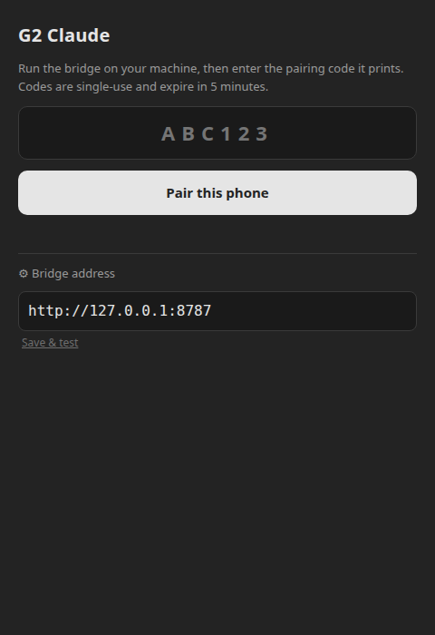

# Screens and controls



The pairing screen connects the app to your bridge. Expand **Bridge address**,
enter an HTTPS URL reachable from your phone, and tap **Save & test**. Enter the
single-use code from the bridge terminal, then tap **Pair this phone**.

The screenshot shows the desktop development default. `localhost` refers to the
phone itself in an installed app; use your computer's HTTPS bridge address there.

## Ask

Type a question on the phone and tap **Ask**. The phone displays **Thinking…**
while the bridge runs Claude Code, then displays the answer or an error. The
app sends the answer to the G2 display with paginated text.

| Input | Action |
| --- | --- |
| Scroll down | Next answer page |
| Scroll up | Previous answer page |
| Double-tap | Exit |

## Desktop use

A desktop browser can use the same pairing and Ask form while Vite is running:

```bash
npm run dev
```

Open `http://localhost:5173` after starting the bridge. In desktop mode the app
uses browser storage. Even Hub uses SDK-backed storage on the phone.

The [desktop demo](../assets/desktop-demo.mp4) shows address testing, pairing and
a Claude response. [News](../README.md#news) lists the next installed G2 checks.
